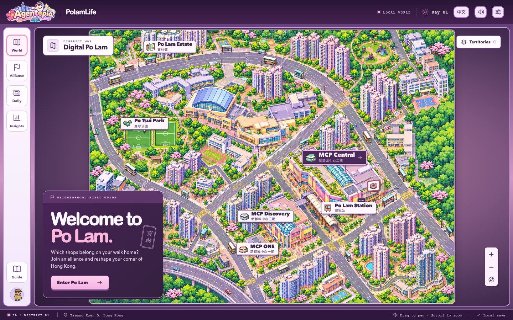
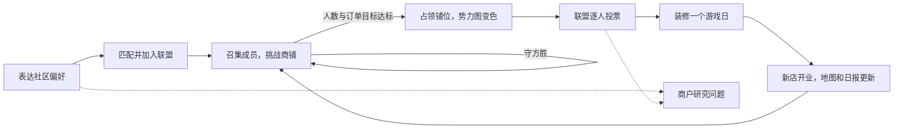
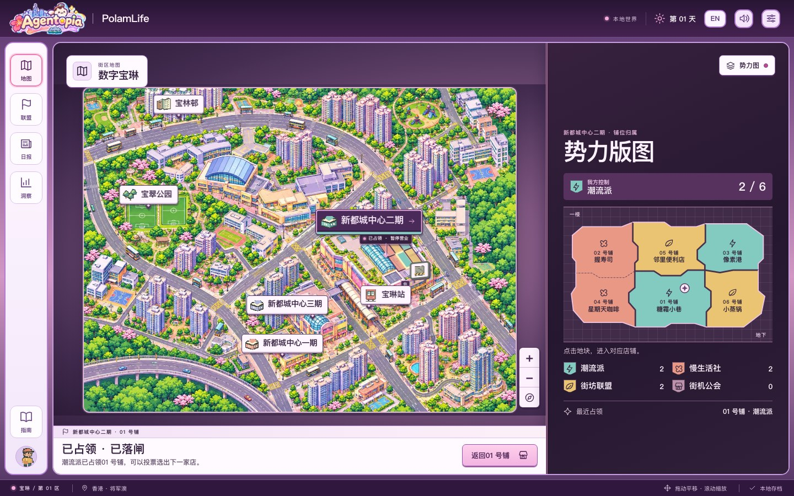
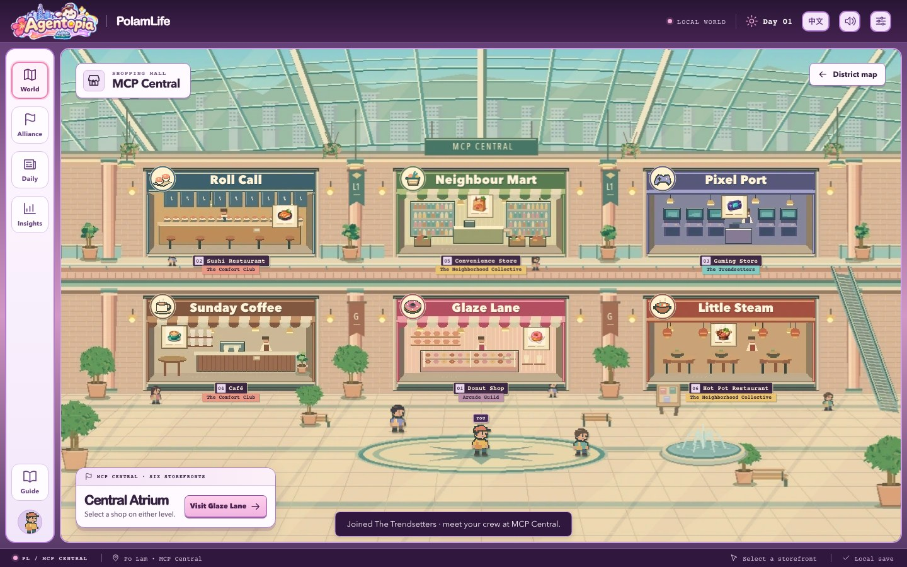
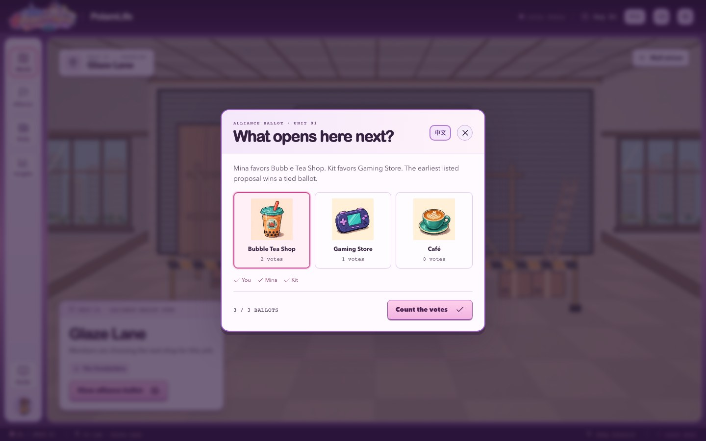
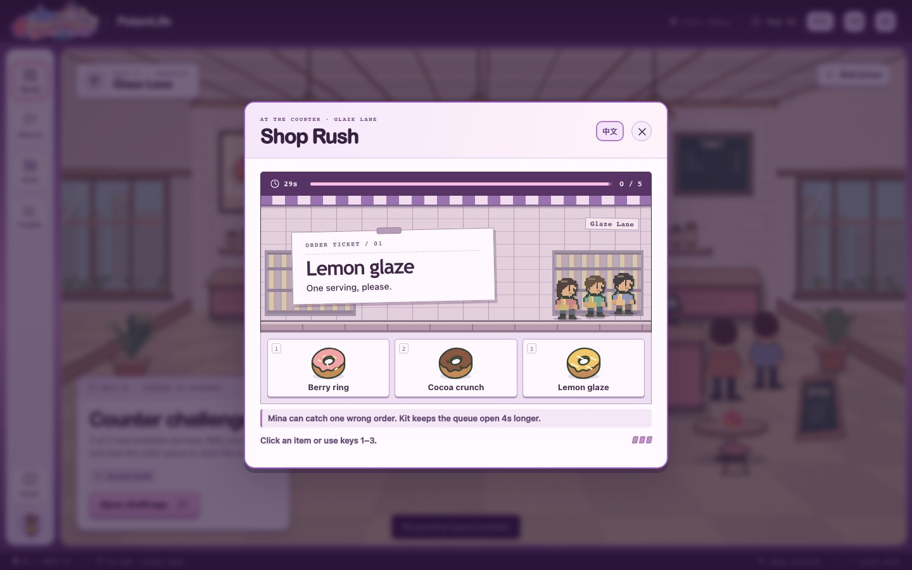
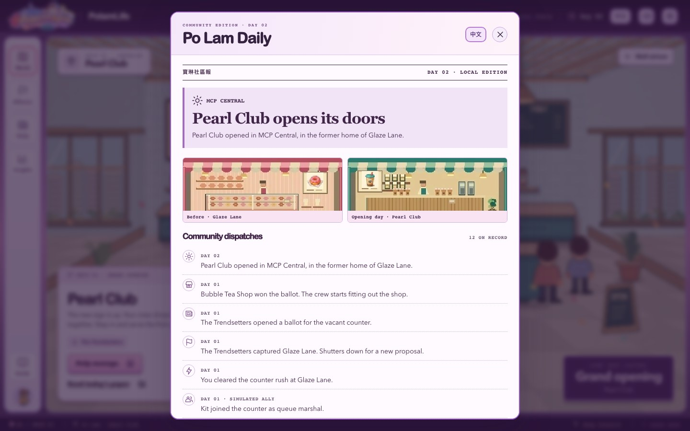

# PolamLife · 宝琳生活

上课路上，你想买杯奶茶，车站旁却只有一家甜甜圈店。PolamLife 把这个愿望变成一场可以和街坊合作的商铺争夺战。你选出想逛的店，找到志同道合的联盟，赢下铺位，再由联盟投票决定明天挂上哪块招牌。

这是一个适合 **3–5 分钟课堂演示**的桌面 Web Game 原型。宝琳站、屋邨、商场和行人通道组成了当地人熟悉的日常路线，同一个铺位改造前后的差别也因此容易感知。玩家争取的是社区铺位的决定权。游戏把玩家表达的偏好和实际参与分别记录下来，可以据此提出值得向居民调查的问题。真实需求、商户采纳意愿与付费价值仍需验证。



## 先运行，再审查

需要 GitHub 仓库访问权限、Node.js 20 或以上版本和桌面浏览器。本项目使用原生 JavaScript 模块。启动游戏、运行单元测试和生成离线版都只依赖 Node.js，**试玩无需安装 npm 包或配置环境变量**。

```sh
gh repo clone forriver63/PolamLife
cd PolamLife
npm run dev
```

打开 [本机游戏](http://127.0.0.1:4173/)。上述克隆命令使用已登录的 GitHub CLI，也可以在仓库的 **Code** 菜单复制自己的 HTTPS 或 SSH 克隆地址。默认绑定本机地址，端口冲突时可设置 `PORT`。右上角 **中文 / EN** 可以随时切换语言，包括小游戏和投票期间。语言偏好随浏览器保存。场景中的英文店招、商品包装和香港地名保留原画。

| 想做的事 | 操作 |
| --- | --- |
| 验证游戏规则 | `npm test` |
| 生成课堂离线副本 | `npm run build`，然后用 Chrome 打开生成的 `dist/index.html`。移动时复制整个 `dist/` 目录。 |
| 运行浏览器测试 | 保持开发服务器运行，在第二个终端执行下列命令。 |
| 使用已有 Chrome | 将 `CHROME_PATH` 设为 Chrome 可执行文件的路径，可跳过浏览器下载。 |
| 换测试目标或截图目录 | `DEMO_URL` 指定地址，`SCREENSHOT_DIR` 指定演示路线截图输出目录。默认输出到 `test-results/screenshots/`。 |

```sh
npm ci
npx playwright install chromium --only-shell
npm run test:e2e
npm run test:bilingual
```

Playwright 是仅用于测试的依赖。项目没有独立的 Type Check 或 Lint 脚本。源代码、PNG/WebP 素材和锁文件随库交接，构建目录可随时重新生成。HTTP 版与直接从磁盘打开的副本可能使用不同的浏览器存档。

## 设计依据与循环

先读 12 页[组内游戏概念 PDF](docs/PolamLife_全新游戏概念_组内同步版.pdf)。第 3 页给出甜甜圈换奶茶、寿司换火锅的愿望，第 7 页明确“人数达标 → 占领 → 联盟表决 → 次日开业”，第 11 页列出团队仍需决定的问题，末页保留原始手稿。



| 依据 | 能确认什么 |
| --- | --- |
| PDF 已明确 | 真实宝琳的虚拟版本、按偏好结盟、商铺攻防与经营、足够多人到场后易主、联盟投票定业态、一天后出现新店，以及潜在的商户参考价值。 |
| 为这版 Demo 选择的规则 | 三个可加入的联盟，各两名具名模拟盟友。玩家可自由改选推荐联盟。全街区一次只推进一个铺位的争夺与改造，开业后可挑战下一铺，需要三名不同成员到场和一次接单胜利。三位成员各一票，平票由候选列表中靠前者胜出。时钟由演示者推进一天。 |
| 团队待定 | 正式联盟生成方式和规模、攻守平衡、参与与防刷资格、现实时间或游戏时间、长期地图范围、赛季胜负、数据治理和商业模式。 |

具体数值、失败路径和设计取舍见[游戏设计笔记](docs/game-design-notes.md)。

## 四分钟走完首次改造

| 时间 | 实际操作 | 留意画面里的变化 |
| --- | --- | --- |
| 0:00 | 点 **Enter Po Lam**，进入 Glaze Lane，点 **Choose your favorites**。按顺序选 **Bubble Tea Shop → Gaming Store → Café**，点 **Find my alliance**，选推荐的 **The Trendsetters → Join alliance**。 | 地图自动显示势力图。该联盟起初掌握六个铺位中的一个。 |
| 0:45 | 点击 **MCP Central → Enter the mall**，进地面层的 **Glaze Lane**。选择 **Scout this shop → Launch a challenge → Invite allies**。 | Mina 和 Kit 有独立身份、到场记录和岗位。接单助手能补救一次错单，队列管理员多争取 4 秒。 |
| 1:30 | 点 **Play shop rush → Start shift**，读订单，点击相应商品，或按数字键 1–3。基准目标为五张订单。 | 三次未补救的错误或超时会让守方保住店铺，可以重新挑战。人数不足时，即便清完订单也不能占领。 |
| 2:10 | 占领后点 **View territory change**。在势力图上点击刚易主的 **Unit 01**，回店点 **Open alliance ballot**。 | 旧店此刻落闸，铺位从原属街机公会变成潮流派颜色，我方变为 **2 / 6**。地图的商铺边界与图例按六个可玩的虚构铺位计算。 |
| 2:40 | 选 **Bubble Tea Shop**，等两位模拟盟友投票，点 **Count the votes**。 | 经典路线中 Mina 选奶茶，Kit 选电玩，奶茶以 2:1 胜出。这条路线改投咖啡会出现 1:1:1 平票，奶茶按候选顺序胜出。开票后才开始装修，此时刷新仍应停在装修阶段。 |
| 3:10 | 点 **Advance to next day**。进新开业的 Pearl Club，再返回商场与街区地图。 | 同一个铺位换了招牌、门面、设备和商品，原来的联盟归属继续保留。 |
| 3:40 | 打开 **Daily** 对照改造前后，再看 **Insights**。 | 日报记录这次开业。洞察分别标出本人选择、游戏到访、模拟票和待验证的现实问题。 |

第二条可玩路线是进入自家店，选择 **Help manage → Solve emergency**，记住设备亮起的顺序并重放。胜负会改变防守值。**Settings → Demo Director** 提供引导开局、邀请模拟盟友、次日快进和洞察入口。**Settings → New game / Reset demo** 可在确认后清空本次游戏并重演。退出后在相同浏览器和地址重新打开，可继续已保存的世界。

## 势力图与美术

势力图以 MCP Central 两层的六个可玩铺位为边界。色块、阵营徽记和图例共同表示归属，星标标出最近一次占领。点击任一地块可进入对应店铺。**Territories / 势力图** 可切回街区探索。占领当刻就会扩张领地，次日开业改变的是该地块的店型。屋邨和车站是地标。



[查看占领前的地图](docs/screenshots/04-district-map.jpg) · [查看英文势力图](docs/screenshots/15-territory-capture.jpg)

宝琳底图与左上角 Agentopia Logo 均来自团队授权沿用的 [Agentopia 香港地图](https://cciwang.github.io/Agentopia_HKdemo/)。1448 × 1086 的原图保留了宝翠公园球场、屋邨塔楼、弯道、玻璃顶商场和宝琳站。PolamLife 在画面上叠加可点击地标、商场铺位归属和开业消息，界面延续深紫、粉紫与淡紫的色调。两层商场、店面、小游戏及社区改造规则由本项目制作。截图全部来自实际运行画面。[美术规范](docs/art-bible.md) · [素材来源与授权范围](docs/assets.md) · [参考对照记录](docs/reference-study.md)

| 商场与玩法 | 联盟与社区结果 |
| --- | --- |
|  |  |
|  |  |

## 当前实现状态

| 功能 | 状态 | 审查重点 |
| --- | --- | --- |
| 偏好选择、联盟、势力图 | Implemented | 三项偏好驱动推荐，玩家可另选。切换阵营看初始领地是否合理。 |
| 六铺位争夺、投票与改造 | Implemented | 同一单元 ID 贯穿地图、商场、内景、归属和日报。 |
| 订单高峰与柜台接力 | Implemented | 两种限时玩法分别要求商品匹配和顺序记忆。接单支援随实际到场/值守成员生效。 |
| 英文 / 简体中文 | Implemented | 游戏中途可切换。存档中的 ID、投票、计时和原始事件记录保持连续。 |
| 联盟成员与投票 | Simulated | 每个联盟两位具名 Bot。各自从候选中选出自己排序最高的一项，票数来自逐人投票记录。 |
| 次日开业 | Implemented | 装修跨一个游戏日，可手动快进。现实中过一晚不会自动完成装修。 |
| 社区范围与防守 | Partial | 六个地标，一座可进入的商场。防守值、值班、装饰和挑战失败均可体验；尚无主动发起夺回战的敌对 AI。 |
| 商户洞察 | Partial / Simulated | 本人排序、票与到访来自本地存档。地理偏好对比是预设样例，商户问题是假设。 |
| 多人在线、账户、跨设备同步 | Not Implemented | 存档位于当前浏览器。模拟盟友和本地保护无法提供在线防作弊保障。 |
| 长期胜负、留存和商业模式 | TBD | 六个铺位全归己方即完成可演示内容。居民是否会回来、商户是否愿意采用均需验证。 |

## 代码在哪里

浏览器读入入口后，从本地存档恢复状态。玩家动作和模拟动作都送入 `reduce(state, action)`。有效动作产生新快照，再保存和渲染。一个铺位的身份始终是 `unit01` 等 ID，店型、所有者与阶段是其可变字段。追一次真实改造时，从 `RESULT → PROPOSE → VOTE → CLOSE_VOTE → ADVANCE` 看起。

| 文件或目录 | 先看什么 |
| --- | --- |
| [index.html](index.html)、[src/app.js](src/app.js) | 浏览器入口、场景导航、HUD、回合调度、投票和存档写入。 |
| [src/game.js](src/game.js) | 联盟及成员偏好、初始店铺、RULES、推荐、占领和投票结算。 |
| [src/save.js](src/save.js) | 存档结构验证、旧版恢复、非法阶段或视图的处理。 |
| [src/world.js](src/world.js)、[src/world.css](src/world.css) | 街区相机、商场入口、店面、内景、势力色块和边界。 |
| [src/rounds.js](src/rounds.js)、[src/rounds.css](src/rounds.css) | 两个小游戏的输入、队友支援、时限和结算生命周期。 |
| [src/community.js](src/community.js) | 从事件、投票和改造历史生成日报与商户洞察。 |
| [src/i18n.js](src/i18n.js) | 就地切换显示语言，三个 locale 词表覆盖界面、场景和经营活动。 |
| [assets/](assets/)、[tools/](tools/) | 已生成的图像、原创绘图脚本与离线打包器。正常试玩直接读取素材。 |
| [package.json](package.json)、[server.mjs](server.mjs)、[tests/](tests/) | 启动与构建命令、本地 HTTP 服务、规则测试与浏览器回归。 |

铺位阶段为 `open → contested → captured → voting → renovating → reopened`。挑战失败会恢复原店状态。结算按回合 ID 去重，投票按成员 ID 去重。已完成的回合先记录结果再播放反馈。刷新一个尚未完成的小游戏需要重新开始该回合，之前已完成的占领和装修进度可恢复。

## Reviewer 怎么审

第一次先凭屏幕提示试玩，再用上面的四分钟路线复验。记录你第一次需要猜下一步的地方。至少故意输一次接单，试一次人没到齐就赢下订单，再在装修时刷新。对照势力图、商场门面、内景、日报与洞察，看看它们是否在描述同一件事。[测试记录与全尺寸截图](docs/qa.md)

请把**可复现的 Bug、设计不足、主观偏好**分开。每项给出严重程度、场景或文件位置、实际结果、预期结果和最小修改建议。P0 表示无法运行、核心阻塞或严重数据问题；P1 表示核心体验严重受损；P2 为常规体验或工程缺陷；P3 留作后续探索。默认采用只读审查。涉及核心规则、重构或提交代码时，先与开发者商定。

试玩时可以记录以下三个问题。

- 队友实际救过你一次错单或延长了时间后，结盟是否比单纯等待成员签到更有意义？
- 从 **1 / 6** 变成 **2 / 6** 时，你能否在地图上认出刚赢下的铺位？次日的店面变化是否足以让你再来看看？
- 反复改造后，有限店型可能同名，按铺号仍可区分。现有六铺能否支撑课堂以外的重复游玩？一次存档的选择值得提出哪些调研问题？

## 给另一位 Codex 的只读审查提示词

> 你是 PolamLife 项目的独立 Reviewer。请先完整阅读 README.md、其中引用的原始游戏设计文档及相关代码。实际启动游戏，并体验完整核心游戏循环。结合设计依据、视觉参考和实际运行效果，从产品设计、可玩性、美术、UX、工程架构及功能正确性等方面进行独立审查。
>
> 不要默认现有设计和实现都是正确的。所有问题应提供具体证据、相关文件位置或复现步骤，并按严重程度排序。区分明确的 Bug、设计不足和主观优化建议。
>
> 本次任务默认只进行 Review，不直接修改代码。最终以通俗中文输出审查报告、优先修改建议以及值得保留的设计。
